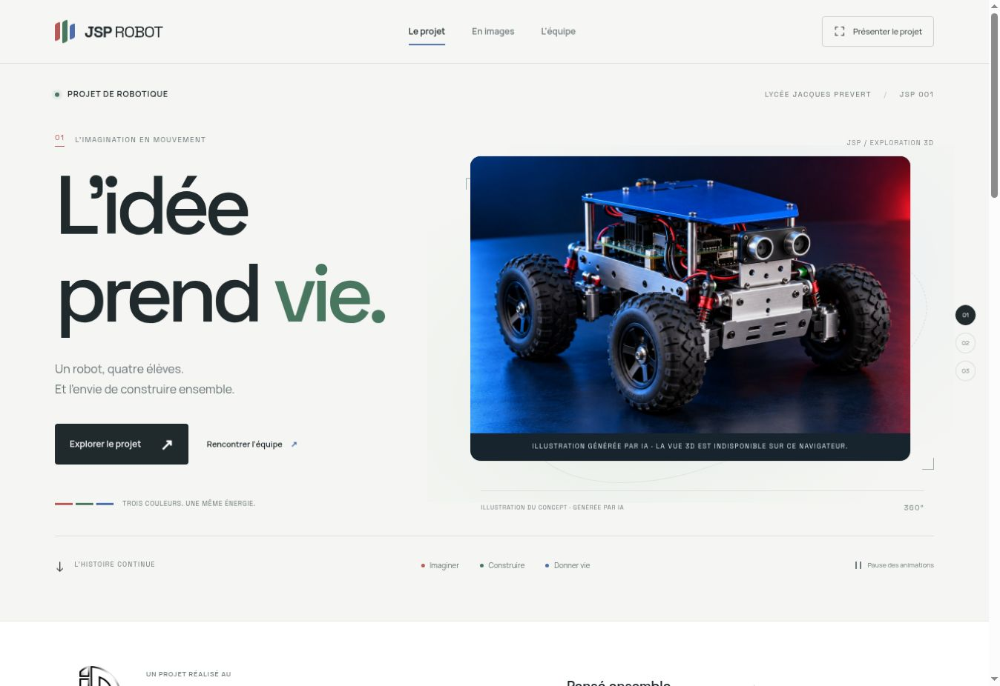

# JSP Robot — mBot Ranger & suivi de ligne

Сайт команды Morgan Bastos saidani, Enzo Baron, Mohamed Diakhate и Fedor Batin, Lycée Professionnel Jacques Prevert.

Содержание следует печатному заданию «Séance 1 — Présentation du projet et découverte». Чужие рукописные ответы и имена с фотографий не перенесены. Четыре раскрывающихся раздела сохраняют последовательность занятия: 25 + 35 + 50 + 10 минут.

В разделе «La séance» находятся контекст проекта, состав группы, план S1–S18, характеристики mBot Ranger 90092, датчики, исполнительные устройства, три конфигурации, знакомство с mBlock 5, упражнение со спрайтом, итоговые вопросы и алгоритм для четырёх состояний двух датчиков.

Руководитель группы, дата выдачи роботов, масса и габариты собранной модели не выдуманы: их нужно уточнить или измерить. Содержание занятий S2–S18 обозначено как предложение до сверки с отдельным cahier des charges.

`downloads/S1_suivi_ligne_JSPRobot.mblock` — нативный учебный проект mBlock 5 с оригинальным фоном, спрайтом и блоками. Его структура, связи блоков и контрольные суммы ресурсов проверены автоматически. Открытие и выполнение в mBlock не подтверждены: проверочная браузерная среда потеряла доступ во время импорта и не поддерживала WebGL.

`downloads/S2_algorithme_JSPRobot.txt` — алгоритм на французском для следующей сессии. Поиск потерянной линии ограничен двумя секундами; это предложенная настройка для будущих физических испытаний.

Изображения настоящего mBot Ranger получены из официальной документации Makeblock. Процедурная 3D-сцена — авторская интерпретация конфигурации Land Raider, а не точная CAD-модель. Полная привязка к заданиям: `docs/seance-1-requirements.md`.

## Запуск

Готовый сайт находится в корне репозитория и работает на GitHub Pages без серверной части и без сборки при публикации. Все шрифты, изображения и 3D-библиотека загружаются из самого репозитория, без внешних CDN. Ссылки на документацию и редактор mBlock открывают внешние сайты.

Локально запустите HTTP-сервер из корня:

```sh
python3 -m http.server 4173
```

Откройте `http://localhost:4173`. Открытие `index.html` двойным щелчком (`file://`) не подходит для ES-модулей и загрузки 3D-файлов.

## Как поставить свою 3D-модель

1. Экспортируйте модель из Blender или другого редактора в **glTF Binary (.glb)**. Включите материалы и текстуры в один файл. Используйте стандартные PBR-материалы; для этой простой интеграции выключите Draco/Meshopt-сжатие и KTX2-текстуры.
2. Положите файл в `models/robot.glb`.
3. В `model-config.js` замените `url: null` на `url: './models/robot.glb'`.
4. Сохраните изменения. **Пересобирать сайт не нужно.**

Модель автоматически центрируется и вписывается в сцену. Если она смотрит в другую сторону, поправьте `rotation` в том же файле: например, `[0, Math.PI, 0]` разворачивает её на 180°. `scale` задаёт дополнительный масштаб. Если в файле есть анимация, проигрывается первый клип; `animate: false` отключает её.

```js
export const MODEL_CONFIG = {
  url: "./models/robot.glb",
  label: "JSP — Notre robot",
  rotation: [0, 0, 0],
  scale: 1,
  animate: true,
};
```

Пока `url` равен `null`, отображается демонстрационная интерпретация Land Raider, созданная программно из геометрии. Это **концепт, а не точная модель реального школьного робота**; подпись на сайте явно это указывает. Если ваш GLB не загрузится, демонстрационный робот останется видимым. Для быстрой загрузки на телефонах старайтесь держать модель в пределах 5 МБ, а текстуры — до 2048 × 2048.

## Реальные фотографии

На сайте используются официальные изображения из `assets/makeblock/`; прежние иллюстрации в `assets/demo/` сохранены как архив. Чтобы заменить любую из них:

1. Добавьте фотографию в `images/`, например `images/atelier.jpg`.
2. В `photo-config.js` укажите соответствующий путь, например `atelier: './images/atelier.jpg'`.

Поддерживается любой формат, который открывает браузер: JPEG, PNG, WebP и AVIF. Подпись об источнике исчезает только после успешной загрузки реального фото. При неправильном пути останется исходная иллюстрация. В отличие от прежней версии, сайт не перебирает несуществующие файлы при каждом открытии: пути теперь задаются явно.

Логотип находится в `images/logo-lycee.png`. Исходный файл не изменён и отображается в обычном виде на светлой основе.

## Управление и доступность

- Потяните 3D-робота влево или вправо для вращения. На телефоне вертикальный жест продолжает прокручивать страницу.
- С клавиатуры: перейдите к 3D-сцене через Tab, затем используйте ← / →. Home или кнопка «Réinitialiser» возвращают исходный ракурс.
- «Pause des animations» останавливает автоматическое движение и появления. Ручное вращение остаётся доступным.
- При включённом системном уменьшении движения автоматические анимации отключены; галерея и презентация работают с мгновенными переходами.
- 3D-рендеринг останавливается, когда сцена вне экрана или вкладка скрыта. Без WebGL2 остаётся подписанная иллюстрация, навигация и всё содержание сайта.
- На компьютере обычный указатель дополнен небольшим контурным кольцом. На сенсорных устройствах и при уменьшении движения оно отключено.
- Без JavaScript все четыре изображения галереи остаются доступными друг под другом.

## Редактирование кода

| Файл                    | Назначение                                     |
| ----------------------- | ---------------------------------------------- |
| `index.html`            | Содержание, имена, разделы и метаданные        |
| `styles.css`            | Дизайн, адаптивность, анимации появления       |
| `js/app.js`             | Меню, пауза, появления, фотографии             |
| `js/robot-scene.js`     | Исходник 3D-сцены и демонстрационного робота   |
| `model-config.js`       | Подключение вашей модели без пересборки        |
| `photo-config.js`       | Подключение реальных фотографий без пересборки |
| `assets/robot-scene.js` | Собранная 3D-сцена с Three.js для публикации   |

Если меняете `js/robot-scene.js`:

```sh
npm ci
npm run build:lesson
npm run build
npm run check
npm test
```

Добавляйте обновлённый `assets/robot-scene.js` в тот же коммит. При изменениях HTML, CSS, фотографий и файлов конфигурации сборка не нужна. Three.js и esbuild закреплены точными версиями в `package-lock.json`.

## Сторонние компоненты

Three.js — MIT (`assets/THREE-LICENSE.txt`). Space Grotesk и Manrope — SIL Open Font License, лицензии сохранены рядом со шрифтами в `assets/fonts/`. Новая внешняя модель робота не используется.

## Проверка изменений

`npm test` запускает проверки интерфейса в jsdom и учебного алгоритма: содержимое, ссылки и локальные изображения, галерею, жесты, мобильное меню, навигацию презентации, отказ полноэкранного режима, уменьшение движения и резервное отображение при недоступной 3D-сцене. Отдельная проверка проецирует геометрию вездехода при полном обороте на пять соотношений сторон, чтобы исключить обрезание модели камерой.

Это проверки логики и геометрии; они не заменяют визуальную проверку в настоящем браузере. Для просмотра запустите сайт по HTTP и проверьте широкое и узкое окно.

## Вид обновлённого сайта



Архивный снимок оформления до сокращения текста и добавления учебного задания. В проверочном браузере отключён WebGL, поэтому показано резервное изображение; 3D-вездеход включается в браузере с поддержкой WebGL2.

Стили и скрипты подключены с версией `?v=lesson-1`, чтобы после обновления не смешивались файлы из разных выпусков. При следующем изменении этих ресурсов обновляйте версию в `index.html` и, для 3D-модуля, в `js/app.js`.
